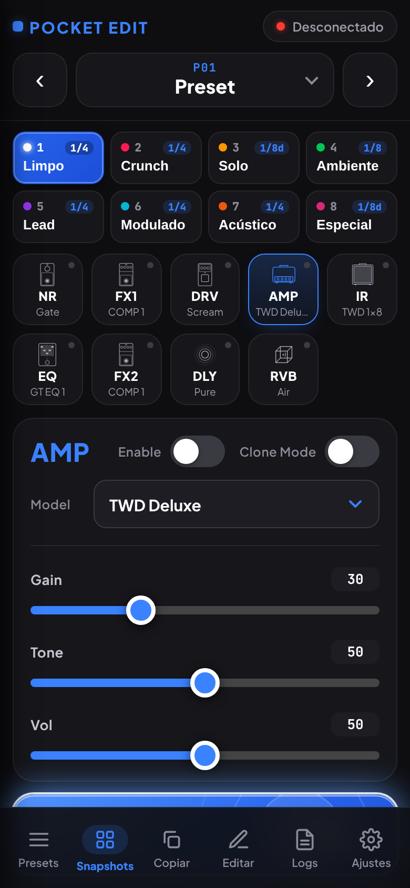
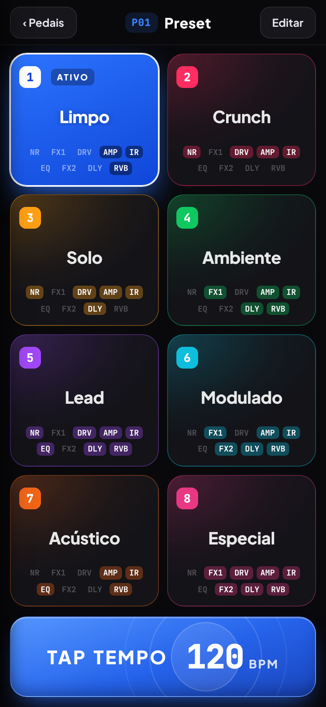
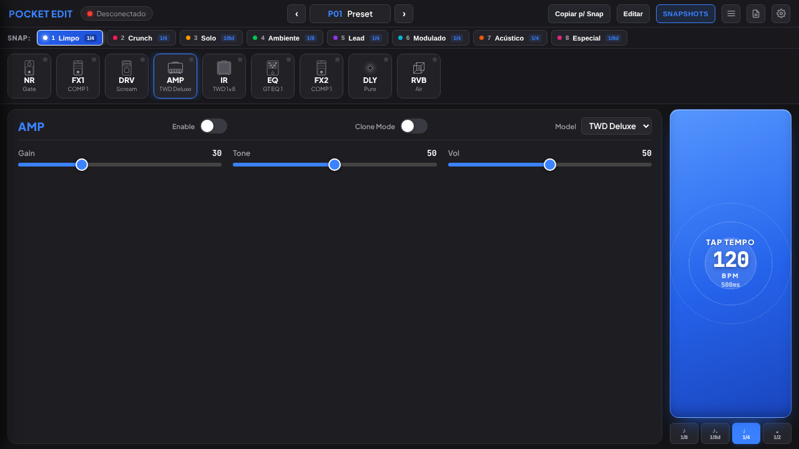

# Pocket Edit

Editor para a pedaleira **Sonicake Pocket Master** que roda direto no navegador, por USB (WebMIDI) ou Bluetooth. É um único arquivo HTML: não precisa instalar nada, e pode ser adicionado à tela inicial do celular como app.

Esta versão é um fork do [PocketEdit original](https://github.com/suckyble/PocketEdit), com interface em português, **modo Snapshots para palco** e layout pensado para celular.

**Abrir o app:** [https://ocarlosads.github.io/pocket/](https://ocarlosads.github.io/pocket/)

| Tela de pedais (celular) | Snapshots (celular) |
| --- | --- |
|  |  |

---

## O que ele faz

- **Edição em tempo real:** mexa em qualquer parâmetro e ouça na hora.
- **Cadeia de efeitos visual:** os 9 módulos (NR, FX1, DRV, AMP, IR, EQ, FX2, DLY, RVB) aparecem de uma vez; toque em um para editar.
- **Presets:** navegue pelos 50 presets de usuário e 50 de fábrica, com busca.
- **Sincronização:** ao conectar, o app lê do pedal os nomes dos presets, os efeitos, os IRs e as capturas (User Profiles) carregados.
- **Via dupla:** mudanças feitas no próprio pedal aparecem no app.
- **Tap Tempo:** marque o andamento e escolha a figura rítmica (1/8, 1/8 pontuada, 1/4, 1/2) para o tempo do delay.
- **Funciona offline** depois da primeira abertura (PWA).

## Snapshots

Cada preset tem **8 snapshots**: cenas que você alterna com um toque, sem trocar de preset.

- **O que cada snapshot guarda:** pedais ligados/desligados, knobs, modelo de amp ou captura, ordem da cadeia e figura rítmica do delay.
- **Padrões do preset:** as bandas do EQ e o Bass/Middle/Treble do amp valem para todos os snapshots do preset (aparecem com a etiqueta "padrão"). O Vol do EQ, o Gain e o Vol do amp são por snapshot.
- **Salvamento automático:** o que você mexer é gravado sozinho no snapshot ativo. Se mudar de ideia, o botão **Desfazer** devolve o snapshot ao estado de quando você entrou nele.
- **Copiar:** o botão "Copiar" leva o som atual para outro snapshot.
- **Tempo do delay:** segue sempre o BPM atual e a figura rítmica do snapshot.
- **Tela de palco:** o botão "Snapshots" abre os 8 em cartões grandes, com o Tap Tempo embaixo. Só o snapshot ativo fica totalmente colorido.
- **Backup:** em Ajustes dá para exportar e restaurar todos os snapshots em um arquivo `.json`. Eles ficam guardados no navegador, então vale exportar de vez em quando.

## Requisitos

- Uma **Sonicake Pocket Master**.
- **USB (recomendado):** Chrome, Edge ou Firefox.
- **Bluetooth:** navegador baseado em Chromium (Chrome, Edge, Brave), que tenha Web Bluetooth.

## Como começar

1. Abra o [app](https://ocarlosads.github.io/pocket/) ou uma cópia local do `index.html`.
2. Toque no indicador de conexão no topo (ou em "Conectar", na lista de presets).
3. Escolha USB MIDI ou Bluetooth. No Bluetooth, selecione **"Sonic Master BLE"** e pareie.
4. Aguarde a sincronização terminar. Pronto para editar.

## Créditos

- **Projeto original:** [suckyble/PocketEdit](https://github.com/suckyble/PocketEdit), incluindo toda a engenharia reversa do protocolo do pedal.
- **USB WebMIDI, suporte a Firefox e cálculo de CRC-8:** [hnikolov](https://github.com/hnikolov).
